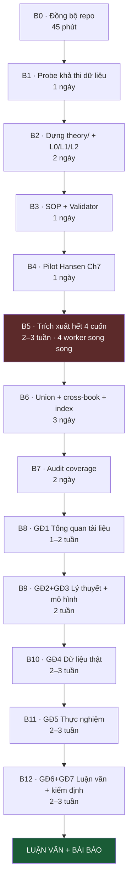

# WORKFLOW — LUẬN VĂN CÁT TRUỒI (IFWST)

> **File chuẩn duy nhất** của quy trình thực thi. Không có file nào khác được phép mô tả quy trình.
> `WORKFLOW.md` ở thư mục gốc là pipeline **mã nguồn** của Giai đoạn 5 (bước `code/01`–`code/07`) — không phải workflow tổng.

- **Dự án:** International Financial Wave–Sandpile Theory (IFWST) / Cát Truồi
- **Thư mục gốc:** `C:\Users\PC\Documents\AI_project\sandbox-financial`
- **Ngôn ngữ:** Tiếng Việt
- **Tạo:** 2026-10-22
- **Mệnh lệnh gốc:** `tasks/init-task.md` (bản gốc, không được sửa)
- **Trang điều hướng:** [`START_HERE.md`](START_HERE.md)
- **Bộ prompt thực thi (13 prompt, dán sẵn đường dẫn tuyệt đối):** [`kilo-prompts-theory/README.md`](../kilo-prompts-theory/README.md)

---

## Cách dùng workflow này

1. **Mỗi phiên làm việc = 1 bước** (hoặc 1 phần rõ ràng của 1 bước). Không làm 2 bước trong 1 phiên.
2. **Sau mỗi phiên:** dán báo cáo theo [§Mẫu báo cáo](#mẫu-báo-cáo-sau-mỗi-phiên), tick bảng trạng thái [§0](#0-bảng-trạng-thái).
3. **Cổng = điều kiện đo được**, không phải cảm nhận. Không có output của lệnh → chưa qua cổng.
4. **Nếu vi phạm điều cấm ở một bước:** dừng bước đó, ghi `BLOCKED` trong báo cáo, và làm bước khác nếu độc lập.
5. **Bị gián đoạn:** đọc [`START_HERE.md`](START_HERE.md) → bảng §0 → biết đang ở bước nào → tiếp tục đúng chỗ.

**Tổng: 13 bước, ~13–16 tuần.** Đường đi tổng thể:



**Cấu trúc tuần tự:** B1→B7 là **kỹ thuật trích xuất tri thức**, xong trước. B8→B12 là **nghiên cứu học thuật**. Hai pha này **không xen kẽ**.

---

## 0. Bảng trạng thái

| Bước | Tên | Trạng thái | Bằng chứng (đường dẫn file) | Ngày |
|---|---|---|---|---|
| B0 | Đồng bộ repo | ✅ | `PROJECT_STATUS.md` · `MEMORY.md` · `00_project_management/task_backlog.md` · `logs/execution_log.md` (4 file viết lại 2026-10-22) | 2026-10-22 |
| B1 | Probe khả thi dữ liệu | 🔄 | đích: `04_data/feasibility_probe.md` | 2026-10-22 |
| B2 | Dựng `theory/` + L0/L1/L2 | ⬜ | | |
| B3 | SOP + Validator | ✅ | theory/docs/EXTRACTION_SOP.md · theory/scripts/validate_theory_layer.py · logs/registry_validation.json · theory/tests/test_validate_theory_layer.py | 2026-10-27 |
| B4 | Pilot Hansen Ch 7 | ✅ | theory/PILOT_REPORT.md · theory/docs/CHAPTER_REPORT_HAN_07.md · theory/books/HAN/units/ch07_units.csv (87 đơn vị) · logs/quality.json | 2026-10-27 |
| B5 | Trích xuất hết 4 cuốn | ⛔ BLOCKED | CẦN XỬ LÝ TOÁN HỌC BỞI SUNG — render-diff 24 phương trình Level C, rebuild 7 Level B, phân đoạn trang pdf=182, reconcile validator schema | |
| B6 | Union + cross-book + index | ⬜ | | |
| B7 | Audit coverage toàn bộ | ⬜ | | |
| B8 | GĐ1 — Tổng quan tài liệu | ⬜ | | |
| B9 | GĐ2+GĐ3 — Lý thuyết + đặc tả mô hình | ⬜ | | |
| B10 | GĐ4 — Dữ liệu thật | ⬜ | | |
| B11 | GĐ5 — Thực nghiệm | ⬜ | | |
| B12 | GĐ6+GĐ7 — Luận văn + kiểm định cuối | ⬜ | | |

Trạng thái hợp lệ: `⬜` chưa làm · `🔄` đang làm · `✅` đã qua cổng · `⛔` BLOCKED (ghi lý do ở cột bằng chứng).

---

## BƯỚC 0 — Đồng bộ repo

**Mục tiêu:** làm repo nói cùng một điều. Đây là tiền đề để mọi bước sau đo được.
**Thời gian:** 45 phút.

| # | Hành động | File |
|---|---|---|
| 0.1 | Tạo trang điều hướng: bảng "file nào trả lời câu hỏi nào" + link tới workflow này | `00_project_management/START_HERE.md` |
| 0.2 | Ghi trạng thái thật từng giai đoạn, kèm **cột bằng chứng** (đường dẫn file) | `PROJECT_STATUS.md` |
| 0.3 | Đổi "Giai đoạn 1 ✅" → `PROVISIONAL` (vì `literature_matrix.csv` rỗng) | `MEMORY.md` |
| 0.4 | Tick đúng những gì đã có bằng chứng; bỏ tick phần chưa làm | `00_project_management/task_backlog.md` |
| 0.5 | Thêm dòng 2026-10-17→22 cho những việc **thực sự** đã làm | `logs/execution_log.md` |
| 0.6 | Ghi quyết định: tầng `theory/` dùng chung; trích xuất hết 4 cuốn trước; tuần tự theo pha, song song theo chương | `00_project_management/decision_log.md` |
| 0.7 | Banner trỏ sang workflow này | `WORKFLOW.md` (gốc) |

**Đầu ra:** 6 file cập nhật.
**Cổng:** đọc `PROJECT_STATUS.md` + `MEMORY.md` + `task_backlog.md` + `execution_log.md` → cùng một kết luận về giai đoạn hiện tại.
**Cấm:** không sửa code, không tải dữ liệu, không mở PDF.

---

## BƯỚC 1 — Probe khả thi dữ liệu

**Mục tiêu:** biết trước 3 tháng có lấy được dữ liệu thật không.
**Vì sao ở đây:** B5 tốn 2–3 tuần. Không được cam kết 3 tuần khi chưa biết dữ liệu có thật hay không.
**Thời gian:** 1 ngày.

| # | Hành động |
|---|---|
| 1.1 | Tải **thử 1 file** từ mỗi nguồn: BIS credit gap · BIS DSR · BIS LBS cross-border · JST Macrohistory · ECB EWI · IMF IFS · Laeven–Valencia crisis dates |
| 1.2 | Ghi từng nguồn: tên file · kích thước · tần suất · phạm vi quốc gia · số biến · có dùng được không |
| 1.3 | Chốt lõi dữ liệu: **JST Macrohistory** (17 nước, 1870–, nhiều sự kiện khủng hoảng → công suất thống kê tốt) **hay** BIS (21 nước, 1990–, quý, biến tài chính đầy đủ) |
| 1.4 | Ghi rõ hệ quả công suất thống kê: với ~15–25 sự kiện khủng hoảng, logit 7 biến sẽ có công suất rất thấp → cân nhắc biến phụ thuộc chính là **biến liên tục** |

**Đầu ra:** `04_data/feasibility_probe.md`
**Cổng:** ≥4/7 nguồn dùng được → đi tiếp. <3 → **dừng, thu hẹp phạm vi trước khi trích xuất sách** (ghi vào `decision_log.md`).
**Cấm:** không xử lý, không ghép panel, không tải toàn bộ.

---

## BƯỚC 2 — Dựng tầng `theory/` + pipeline L0/L1/L2

**Mục tiêu:** biến 4 PDF thành chunk có cấu trúc + chỉ mục tìm kiếm.
**Thời gian:** 2 ngày.

| # | Hành động | File |
|---|---|---|
| 2.1 | Manifest 4 cuốn: mã, tên, tác giả, ấn bản, đường dẫn PDF, số trang, sha256 | `theory/registry/books.yaml` *(tạo)* |
| 2.2 | Script L0 — ingest: text từng trang + TOC + page_map (PDF ↔ trang in) + crop ảnh công thức/hình | `theory/scripts/ingest_book.py` *(tạo)* |
| 2.3 | Script L1 — segment: cắt chunk theo mục, gán `kind`, dựng heading path, ghi ledger coverage | `theory/scripts/segment_book.py` *(tạo)* |
| 2.4 | Script L2 — index: nạp vào SQLite FTS5 (stdlib, không thêm dependency) | `theory/scripts/index_knowledge.py` *(tạo)* |
| 2.5 | Chạy 2.2 cho **HAN** và **MAD** | `theory/books/{HAN,MAD}/` |
| 2.6 | Chạy 2.3 cho **PIN** (text đã có sẵn) và **ROM** (dùng `chapter_ranges` sẵn có làm mẫu) | `theory/books/{PIN,ROM}/chunks.jsonl` |
| 2.7 | Đối chiếu mâu thuẫn PIN: `extract_pdf.json` ghi 787 trang, `coverage.json` ghi 761 trang | ghi chú vào `theory/registry/books.yaml` |

**Đầu ra:** `chunks.jsonl` × 4 cuốn · `coverage.json` × 4 · `knowledge.db`
**Cổng:** PIN **787/787** trang có chunk · ROM **738/738** · HAN & MAD có manifest + page_map · truy vấn `knowledge.db` trả kết quả.
**Cấm:** chưa động vào tri thức (L3+) — đó là B4/B5. Không sửa `research/microeconomics-pindyck-rubinfeld/` hay `research/advanced-macroeconomics-fourth-edition/` (chỉ đọc, tái dùng script).

---

## BƯỚC 3 — SOP + Validator

**Mục tiêu:** viết định nghĩa "một chương coi như xong" thành **quy tắc máy kiểm được**, trước khi giao việc cho worker.
**Thời gian:** 1 ngày.

| # | Hành động | File |
|---|---|---|
| 3.1 | SOP: hợp đồng hoàn thành 1 chương (6 điều kiện) · bảng `kind` (10 loại + trường bắt buộc từng loại) · quy trình toán học 3 bậc A/B/C · quy tắc verify bằng render-diff · mẫu báo cáo chương | `theory/EXTRACTION_SOP.md` *(tạo)* |
| 3.2 | Validator 7 kiểm tra: schema đúng cột/thứ tự · `global_id` trùng · FK `theory_id` → theory registry · `printed_page` + `pdf_page` cùng có hoặc cùng rỗng · `verification_status` ∈ vocabulary · `equation_latex` parse được bằng SymPy · `book_code` + `global_id` có mặt | `theory/scripts/validate_theory_layer.py` *(tạo)* |
| 3.3 | Nâng validator cũ (hiện chỉ đếm dòng) | `research/advanced-macroeconomics-fourth-edition/scripts/validate_registries.py` |
| 3.4 | Chạy validator lên 2 registry hiện có (57 + 29 dòng) | `logs/registry_validation.json` |

**Đầu ra:** SOP + validator.
**Cổng:** validator bắt được **≥1 lỗi thật** trong registry hiện có. Nếu 0 lỗi → validator chưa đủ mạnh, phải siết lại trước khi đi tiếp.
**Cấm:** chưa chạy worker.

---

## BƯỚC 4 — Pilot Hansen Ch 7 (GMM)

**Mục tiêu:** đo chi phí thật trước khi cam kết 2–3 tuần.
**Vì sao chọn Ch 7:** là chương phương pháp quan trọng nhất với luận văn (GMM, điều kiện nhận dạng, Hansen J) → cũng là bài toán toán học nặng nhất, nên đo ở đây có giá trị cao nhất.
**Thời gian:** 1 ngày.

| # | Hành động |
|---|---|
| 4.1 | Chạy đầy đủ pipeline L0→L5 trên 1 chương Hansen |
| 4.2 | Đo 4 con số: **bậc toán học** (A: text layer sạch / B: mất vị trí chỉ số / C: công thức là ảnh) · **giờ thực tế** · **số unit sinh ra** · **tỉ lệ verify tự động pass** |
| 4.3 | Viết báo cáo pilot kèm quyết định: mở rộng cả 4 cuốn / thu hẹp định dạng unit |

**Đầu ra:** `theory/PILOT_REPORT.md` + `theory/books/HAN/units/*.csv` (Ch 7) + `logs/quality.json`
**Cổng:** có đủ 4 con số thật → **ra lệnh B5**.
**Cấm:** không làm chương thứ 2 của bất kỳ cuốn nào. Không chỉnh số đo dự đoán trước.

---

## BƯỚC 5 — Trích xuất hết 4 cuốn

**Mục tiêu:** trích xuất **toàn bộ** 4 cuốn, không phải phần liên quan.
**Cơ chế:** tuần tự theo pha, **song song bên trong pha** — 4 worker độc lập, mỗi worker 1 cuốn, chia nhỏ theo chương. Một chương là unit độc lập, không phụ thuộc chương khác (ID liên chương chỉ cần ở B6).
**Thời gian:** 2–3 tuần.

| Worker | Cuốn | Mã | Số chương |
|---|---|---|---|
| W-HAN | Hansen, *Econometrics* (2014) | `HAN` | 13 |
| W-ROM | Romer, *Advanced Macroeconomics* 4e | `ROM` | 12 |
| W-PIN | Pindyck & Rubinfeld, *Microeconomics* Global 2017 | `PIN` | 19 + Appendix |
| W-MAD | Madura, *International Financial Management* 11e | `MAD` | ~23 |

**Thứ tự trong mỗi chương** (theo `theory/EXTRACTION_SOP.md`):
1. ingest (nếu chưa) → 2. segment → 3. math transcription + verify → 4. điền form units → 5. crop hình + caption → 6. chạy validator chương → 7. đóng ledger → 8. checkpoint.

**Định dạng unit bắt buộc:**
- `equations.csv` — schema 16 cột đã có (giữ nguyên để union được)
- `theories.csv` — schema 19 cột đã có
- `assumptions.csv` · `theorems.csv` · `caveats.csv` · `concepts.csv` · `figures.csv` · `tables.csv` · `exercises.csv` · `bibliography.csv` — mới

**Cổng (mỗi chương — 6 điều kiện, kiểm bằng script):**
1. 100% trang của chương đã gán vào ≥1 chunk
2. 100% chunk có `kind` khác null
3. 100% chunk `kind=prose` có ≥1 unit **hoặc** được đánh dấu `PROSE_ONLY` (không được im lặng)
4. 100% unit có `verification_status` ∈ vocabulary
5. 100% `equation_latex` parse được bằng SymPy
6. 100% figure/bảng có caption + trang + ảnh đã crop

**Cổng (cả pha):** 4 ledger đóng · tổng số trang có chunk = tổng số trang PDF (kể cả trang hình toàn trang) · 0 trang chưa gán.
**Cấm:** không union giữa các cuốn · không sửa file registry của cuốn khác · không viết luận văn · không bỏ qua chương khó (đánh dấu `OUT_OF_SCOPE` **kèm lý do**, vẫn phải segment).

---

## BƯỚC 6 — Union + cross-book + index

**Mục tiêu:** gộp 4 cuốn thành **một** tầng tri thức dùng chung.
**Thời gian:** 3 ngày.

| # | Hành động | File |
|---|---|---|
| 6.1 | Union 4 registry; thêm `book_code` + `global_id` (`EQ-HAN-0001`); **giữ nguyên** ID cũ để không phá MICRO/MACRO | `theory/registry/*.csv` |
| 6.2 | Harvest bibliography 4 cuốn (~1.900 mục → khử trùng) | `theory/registry/bibliography.csv` |
| 6.3 | Quan hệ xuyên sách: `PREREQUISITE_OF` · `USES_EQUATION` · `CONTRASTS_WITH` · `SPECIAL_CASE_OF` · `USES_ASSUMPTION` | `theory/relations.csv` *(tạo)* |
| 6.4 | Bảng ký hiệu thống nhất (Hansen ≠ Romer ≠ Madura cho cùng một thứ) | `theory/notation.csv` *(tạo)* |
| 6.5 | Build `knowledge.db` + index JSON | `theory/index/` |
| 6.6 | Validator toàn cục | `theory/registry_validation.json` |

**Đầu ra:** tầng `theory/` hoàn chỉnh.
**Cổng:** 0 vi phạm FK · 0 `global_id` trùng · tra cứu trả kết quả **< 5 giây** · mọi unit có `global_id` + `book_code` + `verification_status`.
**Bonus:** `bibliography.csv` là **seed** cho `01_literature/literature_matrix.csv` ở B8.
**Cấm:** không sửa `research/*`; chỉ đọc.

---

## BƯỚC 7 — Audit coverage toàn bộ

**Mục tiêu:** chứng minh "trích xuất hết" bằng số đo, và **công khai cả phần chưa xác minh**.
**Thời gian:** 2 ngày.

| # | Hành động |
|---|---|
| 7.1 | Đếm: tổng trang PDF · trang đã có chunk · trang chưa gán (phải = 0) |
| 7.2 | Đếm theo `kind`: definition / assumption / theorem / equation / caveat / prose-only / exercise / figure / table |
| 7.3 | Đếm `verification_status`: VERIFIED / UNVERIFIED / FORMULA_UNVERIFIED / SOURCE_GAP |
| 7.4 | Liệt kê mọi trang đọc lỗi, mọi unit chưa xác minh, mọi phương trình chưa parse được, mọi `OUT_OF_SCOPE` kèm lý do |

**Đầu ra:** `theory/AUDIT.md`
**Cổng:** trang chưa gán = 0 · mọi unit có status ∈ vocabulary · mọi `OUT_OF_SCOPE` có lý do.
**Cấm:** không nâng trạng thái để đẹp. `FORMULA_UNVERIFIED` phải giữ nếu chưa xác minh (xem ví dụ bắt buộc giữ: PT-10-01 trong repo MACRO).

---

## BƯỚC 8 — GĐ1: Tổng quan tài liệu

**Mục tiêu:** xác định khoảng trống nghiên cứu có cơ sở.
**Thời gian:** 1–2 tuần.

| # | Hành động |
|---|---|
| 8.1 | Nạp `theory/registry/bibliography.csv` vào `01_literature/literature_matrix.csv` — mỗi mục `evidence_status=UNVERIFIED`, `full_text_status=NOT_ACCESSIBLE` |
| 8.2 | Tìm kiếm bổ sung 7 nhánh A–G (`tasks/search.md` §5) · **đọc toàn văn** Luna–Zanforlin 2025 (bằng chứng phản bác mạnh nhất) |
| 8.3 | Viết `01_literature/critical_review.md` — tổng quan phản biện **theo cơ chế**, không theo từng bài |
| 8.4 | Viết `01_literature/research_gap.md` — 8 câu hỏi của `tasks/search.md` §7.3, gắn trạng thái `CONFIRMED GAP` / `PROVISIONAL GAP` / `ALREADY ADDRESSED` / `NOT TESTABLE WITH AVAILABLE DATA` / `REQUIRES FURTHER SEARCH` |

**Đầu ra:** `literature_matrix.csv` · `critical_review.md` · `research_gap.md`
**Cổng:** `literature_matrix.csv` **không rỗng**, ≥60 dòng có `evidence_status` thật · `research_gap.md` có ≥1 `CONFIRMED GAP` **và** ≥1 `ALREADY ADDRESSED` · không mục nào ghi "đã đọc toàn văn" khi thực tế chỉ đọc abstract.
**Cấm:** không mở lại PDF 4 cuốn (đã nằm trong `theory/`).

---

## BƯỚC 9 — GĐ2 + GĐ3: Lý thuyết & đặc tả mô hình

**Mục tiêu:** vận hành hóa ẩn dụ thành mô hình kiểm định được.
**Thời gian:** 2 tuần.

| # | Hành động |
|---|---|
| 9.1 | Bảng vận hành hóa **5 khái niệm** (bồi đắp · bào mòn · ngưỡng trạng thái · sóng cực đoan · sóng thứ cấp): định nghĩa toán · đơn vị · nguồn dữ liệu · đại lượng vật lý **không** được mang sang · **hệ quả nếu ẩn dụ sai** |
| 9.2 | Chốt cấu trúc trạng thái: vector 3 chiều `S = (accumulation, erosion, buffer)` — **không** gộp thành chỉ số tổng hợp tùy tiện |
| 9.3 | Vận hành hóa H1–H5: cơ chế · biến phụ thuộc · biến giải thích · biến kiểm soát · dấu kỳ vọng · dữ liệu · giả thuyết đối chứng · **tiêu chí bác bỏ** · phân biệt tương quan / dự báo / nhân quả |
| 9.4 | M1 (tích lũy → kết quả) → M2 (ngưỡng + cú sốc) → M3 (xác suất có điều kiện); mỗi mô hình ước lượng được **riêng biệt** |
| 9.5 | Chiến lược nhận dạng: instrument cho trạng thái nội sinh · điều kiện Hansen J · threshold panel (Hansen 2000) — **trích từ `theory/registry/`** |
| 9.6 | Chốt biến phụ thuộc chính (liên tục hay crisis dummy) theo kết quả B1 + phân tích công suất |
| 9.7 | Chốt claim của luận văn: đo lường → nhận dạng → (giá trị ngoài mẫu là kiểm chứng) |

**Đầu ra:** `02_conceptual_framework/` (cập nhật) · `03_model_specification/` (cập nhật) · `01_literature/research_gap.md`
**Cổng:** mỗi khái niệm có định nghĩa + nguồn + hệ quả nếu ẩn dụ sai · mỗi H có tiêu chí bác bỏ · M1–M3 đủ rõ để triển khai · **mọi phương trình có `global_id` từ `theory/registry/`**.
**Cấm:** không gõ tay phương trình mới mà không ghi vào registry.

---

## BƯỚC 10 — GĐ4: Dữ liệu thật

**Mục tiêu:** dataset đúng với đặc tả, mọi biến truy được nguồn.
**Thời gian:** 2–3 tuần.

| # | Hành động |
|---|---|
| 10.1 | Tải theo kết luận B1: lõi (JST **hoặc** BIS) + bổ sung (ECB EWI, IMF IFS, World Bank, FRED) |
| 10.2 | Dựng 8 tầng: `raw → validated → interim → processed` + `source_registry.csv` + `variable_dictionary.csv` + `formula_registry.csv` + `model_registry.csv` |
| 10.3 | `credit_gap` = **HP filter λ = 400.000** (BIS/JST) — **không** phải rolling mean 5 năm |
| 10.4 | Định nghĩa lại `sandpile_load` · `network_density` · `regime` theo định nghĩa B9 — **không** dùng proxy `1 − capital/10`, `trade_openness/max`, `1{gdp_growth>0}` |
| 10.5 | Kiểm chứng chất lượng: `output/data_quality_report.md` **thật** — có kiểm validness cấu trúc, tần suất, độ phủ, số sự kiện khủng hoảng |
| 10.6 | Dọn pipeline: giữ 1 bản `code/05_derived*.py`, xếp 3 bản trùng vào `code/_superseded/` kèm lý do (không xoá lịch sử) |
| 10.7 | Sửa `code/01_download_bis.py` để **không fallback về World Bank** cho biến mà spec yêu cầu BIS — fallback phải ghi cảnh báo, không im lặng |

**Đầu ra:** `data/` đủ 8 tầng · `output/data_quality_report.md` · `output/panel_summary.csv`
**Cổng:** `credit_gap` khớp BIS/JST · tần suất khớp đặc tả · 0 dòng proxy còn sót · báo cáo chất lượng có kiểm validness.
**Cấm:** không dùng dữ liệu mô phỏng trình bày như dữ liệu lịch sử.

---

## BƯỚC 11 — GĐ5: Thực nghiệm

**Mục tiêu:** ước lượng, kiểm định H1–H5, so sánh công bằng với baseline mạnh.
**Thời gian:** 2–3 tuần.

| # | Hành động | File |
|---|---|---|
| 11.1 | Baseline **mạnh**: EWI chuẩn (credit gap + DSR + house price gap), logit/probit | `code/08_summary.py`, `code/09_baseline.py` *(tạo)* |
| 11.2 | M1 Cát Truồi + interaction trạng thái × cú sốc | `code/10_cat_truoi_m1.py` *(tạo)* |
| 11.3 | Nhận dạng: GMM/IV + Hansen J + threshold panel; kiểm công cụ yếu | `code/11_identification.py` *(tạo)* |
| 11.4 | Ngoài mẫu: expanding window · AUC · Brier · log-loss · Diebold–Mariano vs baseline | `code/12_out_of_sample.py` *(tạo)* |
| 11.5 | Null-result insurance: `specifications_tried.csv` + White Reality Check / Hansen SPA | `code/13_spec_curve.py` *(tạo)* |
| 11.6 | Backtest 2008 & 2020; Monte Carlo cho M3 | `code/14_backtest.py` *(tạo)* |
| 11.7 | Độ nhạy & sai số tham số; so sánh AIC/BIC/RMSE/MAE/AUC | `code/15_sensitivity.py` *(tạo)* |
| 11.8 | Biểu đồ kết quả | `code/16_figures.py` *(tạo)* |
| 11.9 | Báo cáo tổng hợp | `output/IFWST_Final_Report.md` *(tạo)* |

**Đầu ra:** `output/` — kết quả truy được tới mã + dữ liệu.
**Cổng:** baseline mạnh **đã bị đánh bại** hoặc kết quả null **đã được ghi rõ** · mọi con số truy được về script + dòng lệnh · mọi đặc tả đã thử nằm trong `specifications_tried.csv`.
**Cấm:** không bỏ đặc tả thất bại khỏi báo cáo (master-idea §7.12).

---

## BƯỚC 12 — GĐ6 + GĐ7: Luận văn + kiểm định cuối

**Mục tiêu:** luận văn hoàn chỉnh, mọi tuyên bố truy được về bằng chứng.
**Thời gian:** 2–3 tuần.

| # | Hành động |
|---|---|
| 12.1 | Tạo `09_thesis/chapters/` (11 chương) + `build.py` (sinh PDF/HTML) + `claim_evidence_matrix.csv` |
| 12.2 | Viết theo thứ tự Ch 1→11 (Ch 1–6 dùng `theory/registry/`; Ch 7–8 dùng kết quả B11) |
| 12.3 | Mọi bảng/hình **sinh từ code**, không gõ tay |
| 12.4 | Validator trích dẫn: mọi trích dẫn trong `09_thesis/` resolve về 1 dòng `theory/registry/` có status đủ mạnh |
| 12.5 | Đối chiếu `00_project_management/completion_checklist.md` (16 tiêu chí) |
| 12.6 | Rút 1–2 bài báo từ Ch 3–6 và Ch 7–8 |

**Cổng:** `claim_evidence_matrix.csv` đóng (mọi claim → evidence hoặc `OPEN` + lý do) · validator trích dẫn xanh · 16/16 tiêu chí có bằng chứng · kết luận trung thực kể cả khi null.
**Cấm:** không tuyên bố tính mới chưa được kiểm tra; không kết luận nhân quả chỉ dựa trên tương quan.

---

## Lịch 6 tuần chi tiết

| Tuần | Việc | Cổng cuối tuần |
|---|---|---|
| **1** | B0 (45′) → B1 (1 ngày) → khởi động B2 | `04_data/feasibility_probe.md` có; `theory/scripts/ingest_book.py` chạy được |
| **2** | B2 (2 ngày) → B3 (1 ngày) → B4 (1 ngày) | `theory/PILOT_REPORT.md` có 4 con số thật |
| **3** | B5 — 4 worker song song | ≥40% chương đóng ledger |
| **4** | B5 tiếp | ≥75% chương đóng |
| **5** | B5 nốt → B6 | 4 ledger đóng; union xong; `knowledge.db` tra cứu <5s |
| **6** | B7 (2 ngày) → bắt đầu B8 | `theory/AUDIT.md`; `literature_matrix.csv` bắt đầu có dòng |
| **7+** | B8 → B9 → B10 → B11 → B12 | lần lượt theo cổng từng bước |

---

## Mẫu báo cáo sau mỗi phiên

Dán vào chat hoặc `docs/KILO_STATUS.md`:

```
## BÁO CÁO — <BƯỚC> (phiên <n>)

### ĐÃ LÀM
- <đường dẫn file:line> — <việc cụ thể> — <bằng chứng: lệnh + output>

### ĐÃ KIỂM CHỨNG
- Cổng <X>: <tiêu chí> → PASS/FAIL — <số đo>

### CHƯA LÀM / BLOCKED
- <mục> — <lý do> — <cần gì để mở>

### FILE ĐÃ SỬA
<đường dẫn, mỗi dòng một file>

### RỦI RO CÒN LẶI
- <rủi ro cụ thể>
```

---

## Quy tắc bất di bất dịch

1. Mọi khẳng định trạng thái **kèm đường dẫn file**. Không "đã xong" mà không có bằng chứng.
2. **Không nâng trạng thái để đẹp.** `PROVISIONAL` / `FORMULA_UNVERIFIED` hơn `DONE` bịa.
3. **Cổng là số đo, không phải cảm nhấn.** Không có output của lệnh → không đạt cổng.
4. **Trong B1–B7: không tải dữ liệu thật, không viết luận văn.** Nhu cầu phát sinh → ghi `theory/GAP_REQUESTS.md`.
5. **Registry là nguồn duy nhất.** Không gõ tay phương trình vào chương luận văn.
6. **Không sửa PDF gốc** (`data/book/` bất biến). **Không sửa `research/microeconomics-pindyck-rubinfeld/` hay `research/advanced-macroeconomics-fourth-edition/`** — chỉ đọc.
7. **Sửa generator, không vá file sinh ra** (đã áp dụng qua bộ `kilo-prompts/` cho MACRO/MICRO — giữ nguyên).
8. **Không xoá lịch sử nghiên cứu** (`data/`, `extracted/`, `04_catalogs/`, registry CSV, `03_chapter_analyses/`). Muốn bỏ bản cũ → di chuyển sang `code/_superseded/` kèm lý do.
9. **Mỗi phiên:** dán mẫu báo cáo + tick bảng §0.
10. **Bị gián đoạn:** đọc `START_HERE.md` → bảng §0 → tiếp tục đúng chỗ.

---

## Tài liệu liên quan

| File | Vai trò |
|---|---|
| [`START_HERE.md`](START_HERE.md) | Trang điều hướng — mở file này khi bắt đầu phiên |
| `tasks/init-task.md` | Mệnh lệnh gốc (bản gốc, không sửa) — các cụm "PHẦN N" trích về đây |
| `ideas/master-idea.md` | Ý tưởng gốc Cát Truồi (12 phần, H1–H5, M1–M3, sản phẩm A–J) |
| `RESEARCH_MANIFEST.md` | Câu hỏi nghiên cứu + giả thuyết ứng viên |
| `00_project_management/methodology.md` | Quy trình 8 giai đoạn học thuật (GĐ0–GĐ7) |
| `00_project_management/scope_and_boundaries.md` | Phạm vi / ngoài phạm vi |
| `00_project_management/completion_checklist.md` | 16 tiêu chí nghiệm thu cuối |
| `tasks/search.md` | Bản đặc tả GĐ1 — 7 nhánh tìm kiếm, 8 sản phẩm, 12 tiêu chí |
| `skills/academic-book-research-and-learning-engineering/SKILL.md` | Quy trình trích xuất sách (dùng cho cả 4 cuốn) |
| `kilo-prompts/00-shared-contract.md` | Hợp đồng thực thi + mẫu báo cáo + điều kiện DONE/BLOCKED |
| `WORKFLOW.md` (gốc) | Pipeline **mã nguồn** GĐ5 (`code/01`–`code/07`) — không phải workflow tổng |
